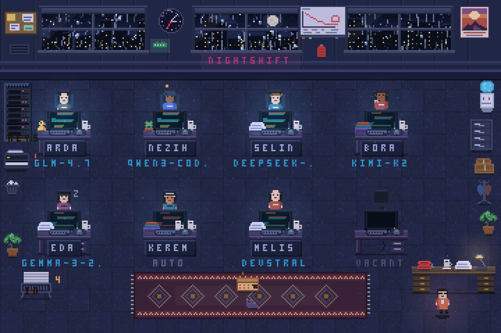
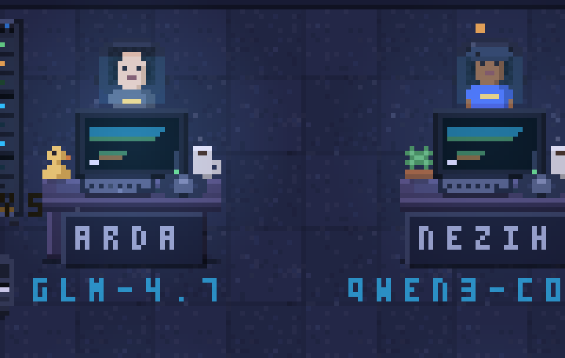
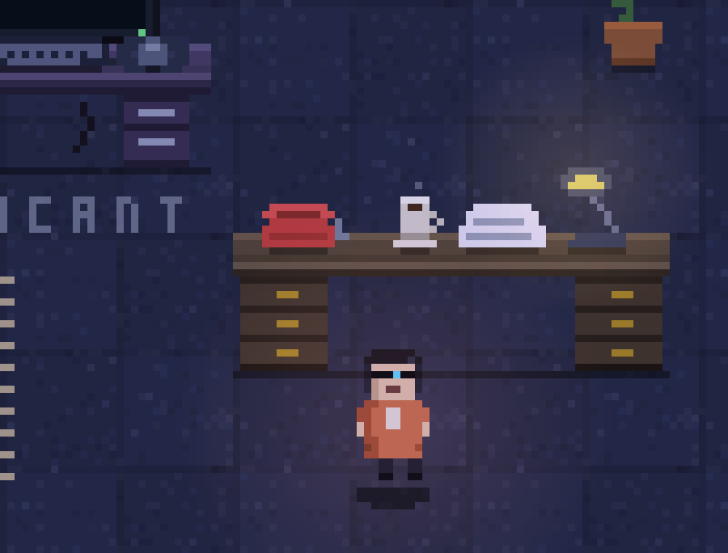
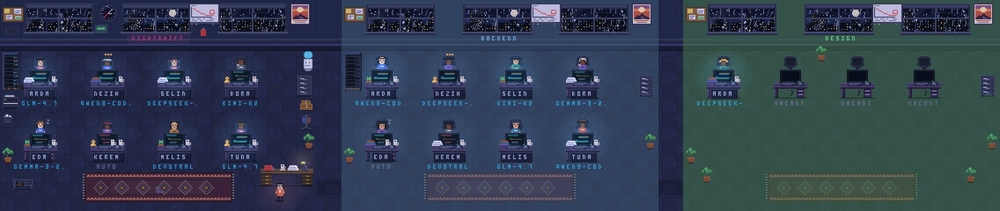
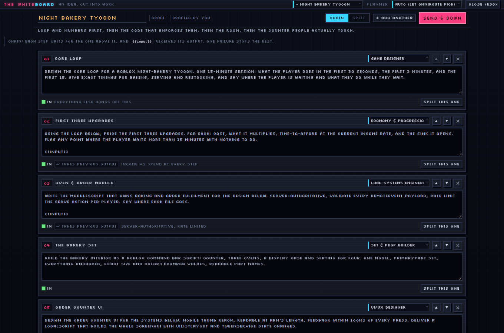
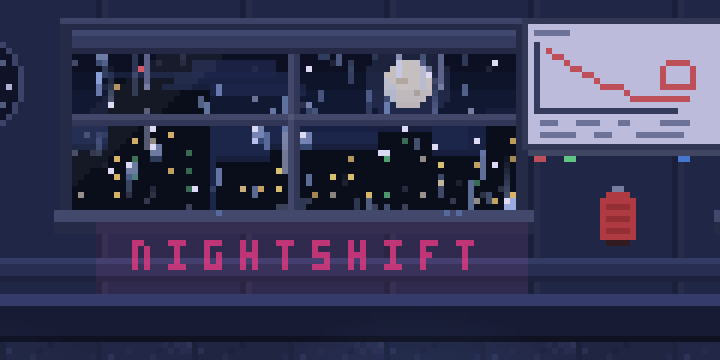

<div align="center">

# NIGHTSHIFT

**A pixel office where cheap models work the night shift and you are the boss.**



[](https://github.com/kaanisthatyou/nightshift/actions/workflows/ci.yml)
[](https://www.npmjs.com/package/@kaandrick/nightshift)
[](LICENSE)
[](https://nodejs.org)

</div>

Every desk on the floor is an agent backed by a real model — NVIDIA NIM, Groq, Gemini,
OpenRouter, a local Ollama, anything OpenAI-compatible, called directly. Give an order and the boss
avatar physically walks to that desk, says the prompt in a speech bubble, and the worker
starts typing. **The monitor scrolls at the speed of the token stream** — what you are
watching is the actual response coming in. Finished work flies into the IN tray and waits
for you to approve it or throw it back.

It is a real tool wearing a costume: a quota-pooling model router, a job queue, batching,
pipelines, an A/B arena, crew loadouts with real personas, and a whiteboard that cuts an
idea into work — with a window you can leave open on a second monitor and actually enjoy
looking at.

Point the floor at a folder and the desks stop describing work and start doing it. In
**build mode** a desk gets real tools — read, write, edit, run — inside that folder only,
each step owns the files it is allowed to touch, and a check has to pass before anything
counts as finished. What lands in your review tray is code that ran, not code that reads
like it would.

Claude Code drives the same floor over HTTP, so the heavy thinking happens in Claude while
the small, boring, repetitive work gets pushed down to free models.

```
  ┌──────────────────────────────────────────────────────────────┐
  │  Claude Code (orchestrator)  ── POST /api/orders ──┐         │
  │  You (the window)            ── click a desk ──────┤         │
  └────────────────────────────────────────────────────┼─────────┘
                                                       ▼
                                        NIGHTSHIFT floor server :20200
                                                       │
                                 the router: one lane per API key
                        ┌───────────────┬──────────────┼──────────────┬───────────────┐
                        ▼               ▼              ▼              ▼               ▼
                    NIM key 1       NIM key 2       Groq key      Gemini key    Ollama (local)
```

---

## Requirements

| | |
|---|---|
| **Node** | 22.6 or newer. The server runs as TypeScript, straight from source. |
| **OS** | Linux, macOS, Windows. Nothing platform-specific, no launcher scripts. |
| **A provider key** | Optional to *start*, required to reach a model. A free [NVIDIA NIM](https://build.nvidia.com) key is the tested path; Groq, Gemini, OpenRouter, Cerebras, Mistral, DeepSeek, OpenAI, Ollama and LM Studio are built in, and any other OpenAI-compatible `/v1` server can be added. |
| **Network at runtime** | None. The pixel font is embedded and every sprite is drawn in code, so the window renders with the cable unplugged. |

## Run it

```bash
npx @kaandrick/nightshift
```

That is the whole thing — it builds the window on first run, serves on **http://localhost:20200** and opens it. `Ctrl+C` closes the floor.

> The npm name is scoped because the registry blocks the bare `nightshift` as too close to
> an unrelated package called `night-shift`. `npm i nightshift` will simply find nothing —
> the scope is the only published coordinate. The command it installs is still `nightshift`.

Or from source, which is what you want if you intend to change anything:

```bash
git clone https://github.com/kaanisthatyou/nightshift
cd nightshift
npm install
npm start
```

Either way the same flags apply:

```bash
npm start -- --port 8080          # somewhere else
npm start -- --no-open            # don't touch the browser
NVIDIA_API_KEY=nvapi-... npm start   # a key from the environment, no clicking
```

Working on it instead of using it:

```bash
npm run dev          # floor :20200 + vite :5180 with HMR, open http://localhost:5180
```

### Keep it current

The floor asks npm on boot whether something newer exists and prints one line if so.
Nothing installs itself behind your back — updating is a command you type:

```bash
npx @kaandrick/nightshift@latest   # npx caches by name, @latest is how you get past it
nightshift --update                # installed it globally? this replaces it
nightshift --version               # what you are actually running
```

What changed between versions is in [CHANGELOG.md](CHANGELOG.md).

From a clone it is `git pull && npm install && npm run build`. The check is a single
request to the npm registry with a 2.5s leash — silence it with `--no-update-check` or
`NIGHTSHIFT_NO_UPDATE_CHECK=1`, and it stays quiet on its own when you are offline.

Your floor survives the update. The crew you hired, their heads, the models on their desks,
the settings and the toolbox live in **`~/.nightshift/`**, not next to the code — npx unpacks
a fresh directory for every version, and a crew kept there would be gone the moment you
updated. Point `NIGHTSHIFT_DATA` somewhere else to keep separate floors:

```bash
NIGHTSHIFT_DATA=~/work/floor-a nightshift --port 20200
NIGHTSHIFT_DATA=~/work/floor-b nightshift --port 20201    # a second office, same machine
```

### Add your keys

There is no gateway to install. Open **mains ▸ providers** and paste keys, one per line —
each is matched to its provider by prefix (`nvapi-`, `gsk_`, `AIza`, `sk-or-`, `csk-`), or
write `mistral = ...` to name it. Keys live in `~/.nightshift/providers.json` and never reach
the browser. The same works from the environment or a file:

```bash
NVIDIA_API_KEY=nvapi-... GROQ_API_KEY=gsk_... GEMINI_API_KEY=AIza... npm start
cp keys.example.txt ~/.nightshift/keys.txt   # read on every boot
npm run keys -- ./my-keys.txt                # or push a file into a running floor
```

**Every key is a lane.** Two NIM keys are two 40-requests-a-minute budgets, and the floor
uses both. See [the router](#the-router--many-quotas-one-conversation).

---

## The floor

 

| thing | what it means |
|---|---|
| desk | one agent, one model, one seat — as many as your office has rooms for |
| name / cyan label | who they are and which model is sitting there |
| monitor scroll speed | live token stream from that model |
| speech bubble | boss orders and worker replies, as they happen |
| morale bar | up when you approve, down when you reject or it fails |
| IN tray | finished work waiting for review |
| payroll | real cost, where the provider publishes a price |
| neon sign | pink = a provider is answering, red flicker = none is |
| rooms | each with its own name, theme and up to eight desks |

Click a desk to select it, `/` focuses the order bar, `Esc` closes a task or the whiteboard.
Three desks are already staffed on first boot so there is something to give an order to.

### Two rules the product will not break

**Unpriced is not free.** Only some providers report pricing. Models it gives no price for are tagged **`no price`**, never `free` — unknown is not
the same as free. Only a known price, or a real per-response cost header, moves the payroll
figure.

**Nothing is invented behind your back.** Every task records which key and model served its
last round (`via nim#2 z-ai/glm-5.3`) and how many lanes carried it. A task that had to leave
its own model for the `auto` route is stamped **`fell back from <model>`**, so you always know
who actually did the work.

And with no provider answering at all, the floor still runs — but every output is marked
`GHOST OUTPUT` and tagged `ghost` in the API. Nothing is sent anywhere and nothing is made
up. Turn it off in mains → house rules.

**A desk never reaches past its folder.** Build mode is the only thing here that touches your
disk, and it does so through a jail rather than through a prompt asking nicely: paths that
resolve outside the working folder are refused, `run` takes an allowlist of build tooling and
nothing else, there is no delete tool, and the folder is put under git before the first write.
See [build mode](#build-mode--desks-that-write-files-not-descriptions-of-files).

## The office — rooms, not a desk limit

**mains ▸ the office** builds the floor plan. Pick a layout — `garage` (4), `floor 13` (8),
`studio` (12), `agency` (20), `campus` (32) — or make your own: up to eight rooms, each with a
name, up to eight desks and a theme (`night shift`, `loft`, `lab`, `greenhouse`, `arcade`).
Rooms sit on a grid joined by hallways; the boss walks down them to reach a desk in another
room, and the camera fits the whole building. Rebuilding never fires anyone — an office
smaller than the crew is refused, and desks that no longer exist move to free ones.



```bash
curl -s localhost:20200/api/office -H 'content-type: application/json' -d '{"layout":"agency"}'
curl -s localhost:20200/api/office -H 'content-type: application/json' \
  -d '{"office":{"name":"lab","rooms":[{"name":"frontend","desks":8,"theme":"night"},{"name":"qa","desks":4,"theme":"lab"}]}}'
```

## Loadouts — a crew, not eight copies of one model

A desk is not just a model with a name on it. Under **crew** you pick a **loadout** and the
crew walks in together: pick *Roblox Studio* and you get a game designer, a Luau systems
engineer, a set builder and a UI designer, each with a system prompt written for that job.
Behind them is a **bench** — `+ add another` gives you the asset & tool scout, the economy
balancer, the playtester, the live-ops desk. Hire, fire, hire someone else.

| loadout | who walks in |
|---|---|
| `roblox` | designer · luau · builder · ui — bench: tool scout, economy, vfx, playtester, live ops |
| `webapp` | product · frontend · backend · design — bench: copy, security, deploy, tests |
| `content` | research · script · titles · editor — bench: thumbnails, distribution |
| `research` | scout · summariser · skeptic · synthesist — bench: sourcing |
| `data` | extractor · classifier · cleaner — bench: schema, analyst |
| `localize` | translator · tone editor · glossary — bench: cultural adapter |
| `venture` | market · strategy · naming · pitch — bench: devil's advocate |
| `general` | generalist · writer · editor — bench: code hand, list machine |

Every desk also gets a **temper** — `perfectionist`, `speedrunner`, `contrarian`, `pedant`,
`showman`, `minimalist`, `paranoid`, `steady` — which is welded onto the role to make that
desk's actual system prompt. Two desks on the same role with different heads give you two
genuinely different answers, which is the point. Open **head** on any file card to read the
prompt, swap the temper, or write your own.

## The whiteboard — plan it before you work it



Some asks are bigger than one desk. Type the whole messy idea into the whiteboard, hit
**span it out**, and it comes back as steps: each with a title, a self-contained prompt, and
a role against it. Then the part that matters — you edit it. Rewrite a prompt, reorder,
untick what you do not want, pin a step to a specific desk, or **split this one** to break a
step into three. Nothing has run and nothing has cost anything yet.

When it looks right, **send it down** as one job:

- **chain** — each step waits for the one above it and `{{input}}` receives its output.
- **split** — every step goes out at once across free desks.
- **waves** — what a build plan does: every step in wave 1 at once, then all of wave 2, and so on.

The plan then shows up in the **plan** tab with live progress while the floor works, so you
can watch it land desk by desk. `plan it` next to the order bar carries whatever you already
typed straight onto the board.

Planning runs on its own model (**mains ▸ planner**) — worth a smarter one than the desks,
since every step inherits its judgement. That call lands on the same payroll as everything
else; nothing is spent quietly.

## Build mode — desks that write files, not descriptions of files

Everything above has the desks answering in words. Point one at a folder instead and it gets
seven real tools — `list_files`, `read_file`, `search_files`, `write_file`, `edit_file`, `run`,
`finish` — and is expected to come back with something on your disk.

```bash
curl -s localhost:20200/api/build -H 'content-type: application/json' \
  -d '{"text":"a portfolio site for a product designer", "workspace":"~/code/portfolio", "plan":true}'
```

A cheap model handed a whole product by itself writes the smallest thing that technically
answers — one `index.html`, three hours later. The floor is built so that does not happen:

1. **The planner acts as tech lead.** It picks a real stack (`react-vite`, `vanilla-vite`,
   `node-api`, `static`), and writes a **contract** every desk receives: the palette as hex
   values *and* the Tailwind token names, the fonts, every file with its exact exports and
   prop types, the shared data interfaces, section ids, and the actual content — names,
   companies, numbers — so eight desks write one site instead of eight.
2. **The floor lays the stack down itself.** Config, entry point, `npm install` — done before a
   single desk sits down, so no model burns twenty minutes remembering how vite is configured.
3. **Steps run in waves.** Wave 1 is the foundation others import (tokens, data, UI
   primitives), wave 2 is every feature at once, wave 3 wires them together. Each step owns its
   files; a write outside them is refused and the desk is told whose file it is.
4. **Every desk knows the whole map** — who writes what, what is already on disk, what is still
   being written — and a design and code bar written for the stack.
5. **Mistakes are caught while the file is still in the model's head.** Every write is parsed
   on the spot (esbuild) and a syntax error comes back in the same tool result. When a desk says
   it is finished, the type checker runs over *its* files only — errors in teammates'
   half-written files and modules still being written are filtered out — and what fails goes
   straight back into the conversation.
6. **Edits land.** `edit_file` falls back to matching whole lines with the indentation ignored, so a
   desk that copies code back two spaces off still makes its change instead of re-reading the
   file for five rounds. A component that positions things `absolute` with nothing `relative`
   to hold them gets a layout warning on write — the desk never sees the page, so the floor
   says what it would have seen.
7. **Long conversations stay cheap.** Old file bodies the desk already wrote or read are cut
   from the history it re-sends every round; on a provider doing fifteen tokens a second, a
   prompt that doubles is a desk that halves.

**Planning is the slow part on a slow provider.** The plan and its contract are one long reply;
GLM on NIM took seven to eleven minutes in testing, for a contract of about 7,000 characters —
[the benchmark](docs/benchmark.md) has the numbers, and what eight free desks built with them.
**mains ▸ house rules ▸ planner** can sit on a faster model than the desks — Groq's
`gpt-oss-120b` drafted a plan in four seconds, but with a contract a third the size, and the
contract is what every desk builds to. Every desk still works on its own model either way.

When the whole job lands the project's own check (`npm run build`) runs once, and if it fails
a desk that owns the **whole** folder is put on repairing it — the only one who can fix a fault
that lives between two files.

### What a desk cannot do

Build mode hands a cheap model write access to a folder, so the limits are enforced in the
server rather than asked for in the prompt:

- **Nothing outside the folder.** Every path resolves through the jail; `..`, absolute paths and
  symlinks that point out are refused. `.git` is off limits, and so is opening your home
  directory or a drive root as a workspace.
- **Build tooling only.** `run` takes an allowlist — npm, pnpm, node, python, pytest, tsc, git
  and friends — checked per `&&` segment, so nothing hides behind a first word. Pipes,
  redirects, subshells, backgrounding and `curl`/`rm`/`sudo` are refused outright. `cwd` never
  leaves the folder.
- **No delete tool at all**, and the folder is git-initialised before the first write, so a bad
  shift is `git diff` away from being understood and `git checkout` away from being gone.

`npm run check:jail` exercises all of that without a model in the loop.

## The router — many quotas, one conversation

A free NIM key allows 40 requests a minute; a busy floor notices. The floor's router is
built around that:

- **A lane per key.** Each key keeps its own clock: requests in the last minute, how many are
  in flight, and — after a `429` — how long it is resting. A request goes to the least-loaded
  free lane that serves the model. When a provider pushes back, that key is asked for fewer
  requests at once, and given its concurrency back slowly once it calms down.
- **The conversation is the state, not the connection.** A desk's work is a list of OpenAI
  messages, and every round is a separate request — so round 3 can be served by `nim#1`,
  round 4 by `nim#2`, and round 5 by Groq if both NIM keys are resting. Tool call ids are
  normalised so any provider accepts the history. **mains ▸ providers** shows every lane live.
- **Routes are quota pools.** A route is models in order of preference
  (`nim/z-ai/glm-5.3 > nim/moonshotai/kimi-k2.6 > groq/openai/gpt-oss-120b`). A desk on a route
  gets the first model with a free key; `auto` is the route everyone can spill over onto.
- **A stalled model is set aside.** A provider that goes silent past its idle limit, returns an
  empty reply or a 5xx is benched for a few minutes and the request moves on; a model a
  provider says it does not serve is benched for half an hour.
- **Thinking is capped.** On a slow provider a reasoning model at full effort can spend its
  whole reply budget thinking — measured on NIM, GLM wrote *nothing* in 1200 tokens at default
  effort and answered at once on `low`. **mains ▸ house rules ▸ thinking** sets it for the floor
  (`low` by default), and each desk can override it.

**A rate limit is a clock, not a failure.** Only when *every* lane that could serve a task is
resting does the desk take a coffee, for as long as the soonest one needs.

## The toolbox — MCP servers on a desk

A desk can be given real tools. Point NIGHTSHIFT at an MCP server and its tools become
callable by whichever desks you hand them to: the model asks for a tool, the floor runs it,
the result goes back into the same conversation, and it repeats until the desk answers in
words or burns `mcpMaxRounds` (6 by default). Every call is recorded on the task — server,
tool, arguments, result, milliseconds — so you can see what a desk actually touched.

There is no panel for it yet; it lives on the API and in `data/mcp.json`:

```bash
# stdio, http and sse all work — or paste a whole mcpServers block from another client
curl -s localhost:20200/api/mcp -H 'content-type: application/json' \
  -d '{"name":"fs","transport":"stdio","command":"npx","args":["-y","@modelcontextprotocol/server-filesystem","."]}'

curl -s localhost:20200/api/mcp                       # who is up, and their tool lists
curl -s -X PATCH localhost:20200/api/workers/<id> -H 'content-type: application/json' \
  -d '{"mcpIds":["<serverId>"]}'                      # hand that server to one desk
```

Two things worth knowing. A desk only sees servers you gave it — nobody gets the whole
toolbox by default, because twenty-six schemas in front of a cheap model is how you get the
wrong tool called. And a stdio server is a child process of the floor: it starts when the
floor does and dies with it. Turn the whole thing off with `POST /api/settings
{"mcpEnabled":false}`.

## Batches, pipelines, arena

Three ways to move volume, all in the board tab and all on the API:

- **Batch** — one template, a list of items, split across whichever desks are free, with
  retries landing on a *different* desk than the one that failed.
- **Pipeline** — steps that feed each other. `{{input}}` is replaced with the previous
  step's output. Draft on a free model, polish on a better one, translate on a third.
- **Arena** — the same prompt to several desks at once, side by side, and you pick the
  winner. It is recorded on that desk. Stop guessing which free model is better.

## Claude Code as the boss

The whole floor is drivable over HTTP:

```bash
# give an order and wait for the answer (this is the one you want)
curl -s localhost:20200/api/orders -H 'content-type: application/json' \
  -d '{"text":"rewrite these 20 commit messages in imperative mood: ...","wait":true}'

# fire and forget, then read it back later
curl -s localhost:20200/api/orders -H 'content-type: application/json' -d '{"text":"...","wait":false}'
curl -s localhost:20200/api/tasks/<id>
```

A Claude Code skill ships in `nightshift-skill/` — the playbook for when to delegate, how to
fan work out across desks, how to run an arena, and how to report back honestly about which
model did what:

```bash
cp -r nightshift-skill ~/.claude/skills/nightshift        # macOS / Linux
```

```powershell
Copy-Item -Recurse nightshift-skill $HOME\.claude\skills\nightshift   # Windows
```

Then just say *"nightshift these"* and hand over a batch.

### API

| method | path | what it does |
|---|---|---|
| GET | `/api/state` | full snapshot: workers, tasks, jobs, ledger, providers |
| GET | `/api/models?refresh=1` | model board with free/price flags |
| GET | `/api/providers` | every provider and lane, redacted, plus the built-in presets |
| POST | `/api/providers` | `{id, baseUrl?, key?, keys?, rpm?, concurrency?, enabled?, params?, models?}` — add or edit one |
| POST | `/api/providers/keys` | `{text}` — paste keys, one per line |
| DELETE | `/api/providers/:id` | drop a provider and its keys |
| POST | `/api/providers/refresh` | ask every provider for its models again |
| POST | `/api/routes` | `{id, models[]}` — an ordered quota pool; `auto` is the default one |
| DELETE | `/api/routes/:id` | drop a route |
| GET / POST | `/api/office` | the floor plan: `{layout}` or `{office:{name, rooms[]}}` |
| POST | `/api/settings` | `{autoAssign?, ghostMode?, maxParallel?, defaultModel?, plannerModel?, reasoning?, routerFallback?, mcpEnabled?, mcpMaxRounds?, workspaceRoot?, buildMaxRounds?, shellEnabled?, repairRounds?, shellExtra?}` |
| GET | `/api/presets` | the loadout catalog: crews, roles, tempers |
| POST | `/api/presets/:id/hire` | `{replace?, roleKeys?, model?, temper?}` — bring a crew in |
| POST | `/api/workers` | `{model?, presetId?, roleKey?, temper?, name?, persona?}` — hire one |
| PATCH | `/api/workers/:id` | `{model?, roleKey?, temper?, persona?, name?, state?, reasoning?, mcpIds?, mcpTools?}` — change the desk, the head, or its tools |
| DELETE | `/api/workers/:id` | fire |
| POST | `/api/orders` | `{text, workerId?, model?, wait?, waitMs?}` — the boss walks over |
| POST | `/api/build` | `{text, workspace?, verify?, files?, plan?, mode?, wait?}` — an order that writes files instead of prose |
| POST | `/api/workspace` | `{path}` — open a working folder (created if missing, put under git). `{path:""}` closes it |
| GET | `/api/workspace/tree` | what is in the folder, and what git says has changed |
| GET | `/api/workspace/file` | `?path=` — one file, to read what a desk actually wrote |
| GET | `/api/workspace/shell` | the command allowlist, and `?command=` to test one without running it |
| POST | `/api/tasks` | same but without the theatre defaults |
| GET | `/api/tasks/:id` | one task with output, tokens, cost, latency, routing decision |
| POST | `/api/tasks/:id/approve` | morale up, task closed |
| POST | `/api/tasks/:id/reject` | `{note}` — sends it back with your note attached |
| POST | `/api/tasks/:id/retry` | run it again |
| POST | `/api/plans` | `{idea, presetId?, stepCount?, workspace?, verify?}` — span an idea out (or pass `steps` to write it yourself). A `workspace` makes it a build plan |
| GET | `/api/plans/:id` | the plan and the tasks it was cut into |
| PATCH | `/api/plans/:id` | `{title?, mode?, verify?, stack?, contract?, steps?}` — edit the board |
| POST | `/api/plans/:id/expand` | `{stepId, count?}` — split one step into several |
| POST | `/api/plans/:id/run` | `{mode}` — `chain`, `split` or `waves`, onto the floor |
| GET | `/api/mcp` | the toolbox: every server, its state and its tools |
| POST | `/api/mcp` | one server, or a whole `mcpServers` block pasted from another client |
| PATCH | `/api/mcp/:id` | `{enabled?, allow?, ...}` — edit and reconnect |
| DELETE | `/api/mcp/:id` | drop it, and take it off every desk |
| POST | `/api/mcp/:id/reconnect` | re-open and re-list its tools |
| POST | `/api/mcp/:id/call` | `{tool, args}` — call one yourself, to check it works |
| POST | `/api/jobs` | `{title, steps:[{title, prompt}]}` — pipeline |
| POST | `/api/batch` | `{title, template, items[], retries}` — one list split across desks |
| POST | `/api/arena` | `{text, workerIds?}` — same prompt to several desks |
| POST | `/api/arena/:id/winner` | `{taskId}` — your call, recorded on that desk |
| POST | `/api/happening` | `{kind}` — make something happen (`pizza`, `gossip`, `cat`, `printer`, `flicker`, `sleepy`) |
| POST | `/api/boss/say` | `{text, workerId?}` — talk to the room |
| WS | `/ws` | every event, live |

---

## Layout

```
bin/nightshift.mjs  the one command: build check, serve, open
server/             floor server: model router, scheduler, REST, websocket
  router.ts           providers, one lane per key, routes, streaming, failover
  engine.ts           who works on what, the tool loop, waves, retries, the theatre timing
  brief.ts            what a build desk is told - the file to edit when desks misbehave
  templates.ts        the stacks the floor lays down before a build starts
  workspace.ts        the jail and the toolbox: files, search, shell, syntax and type checks
  store.ts            state + json persistence (~/.nightshift/floor.json)
  routes.ts           the API above
  planner.ts          the whiteboard: idea -> steps -> one job
  mcp.ts              the toolbox: mcp servers over stdio/http/sse, and the tool loop
web/src/            the window
  pixel/art.ts        every object on the floor as a char grid, DOM-free on purpose
  pixel/sprites.ts    bakes art.ts to canvases, plus the people
  pixel/scene.ts      the renderer: rooms on a grid, rain, lighting, walking, bubbles
  components/         crew, plan, board, wire, mains panels + the whiteboard
tools/              art review, key import, and the checks `npm run check` runs
shared/             types both sides agree on
  presets.ts          the crew loadouts, roles and tempers
  providers.ts        the built-in provider presets
  office.ts           rooms, themes and office layouts
```

## Drawing the pixel art



`art.ts` holds no DOM calls, which lets the art be rendered and looked at without a browser.
Two tools do that:

```bash
npm run art          # every asset on a contact sheet + a room mock, into .art/
npm run shots        # the REAL FloorScene, headless, into docs/
```

`npm run art` fails loudly on the three things that go wrong when you draw with strings: a
row of the wrong length, a character with no palette entry, and an asset that nothing in
`scene.ts` ever draws. Both run in CI — the images in this README are generated by
`npm run shots`, not screenshotted by hand.

More in [CONTRIBUTING.md](CONTRIBUTING.md), including the desk geometry contract every prop
depends on.

## Contributors

The night shift so far. Every contributor gets a building; whoever pushed this month has the lights on, and the empty lots are waiting for your first pull request.

<a href="https://byteland.dev/r/kaanisthatyou/nightshift?ref=readme"></a>

## License

MIT — see [LICENSE](LICENSE).

One exception: the Silkscreen typeface is embedded as base64 so the floor works offline. It
is copyright The Silkscreen Project Authors under the SIL Open Font License 1.1 and is not
covered by the MIT license — details in [NOTICE.md](NOTICE.md).
