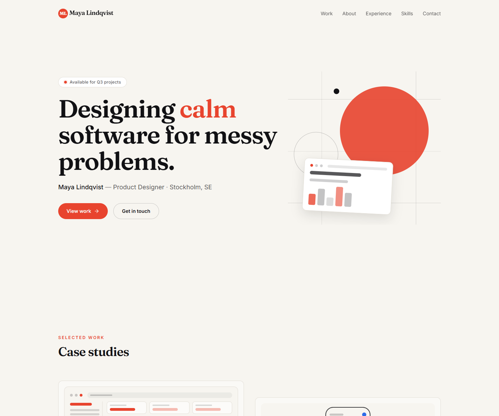
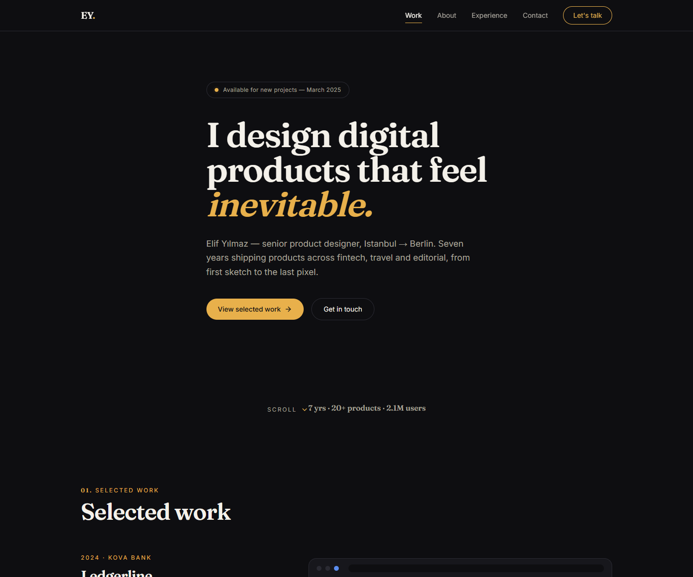
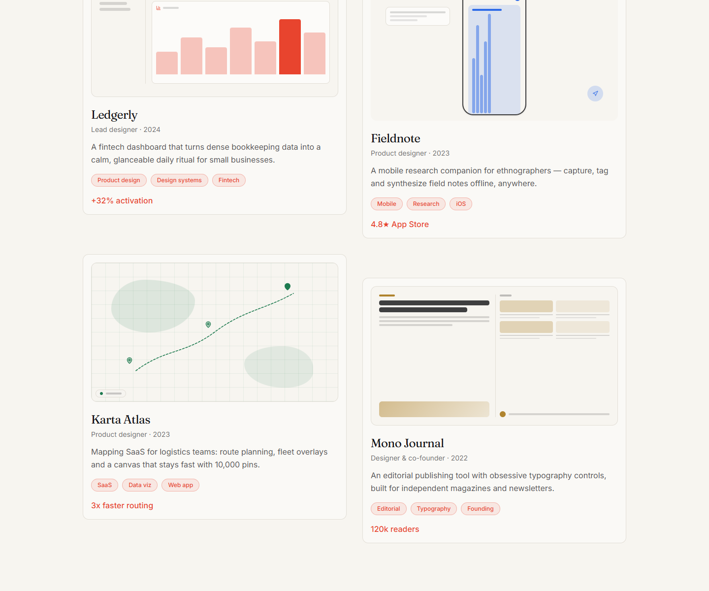
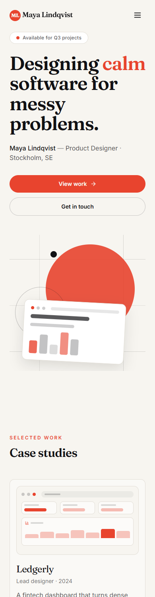

# Benchmark: eight free desks build a portfolio

The question this answers: can a floor of free models, given one sentence, build something
that holds up next to what a frontier model would write by itself? Not a toy page — a real
React project that compiles, looks finished, and works on a phone.

Run on 2026-09-16, against the work that shipped as 0.5.0.



## Setup

| | |
|---|---|
| **Brief** | *Build a portfolio website for a product designer. One page: hero, selected work (case studies), about, experience, skills, testimonials and contact. It should look premium and modern, work well on mobile, and feel like a real designer's site.* |
| **Crew** | 8 desks from the `webapp` loadout — 5 frontend, 3 design — all `perfectionist` |
| **Model** | `nim/z-ai/glm-5.3` on every desk *and* on the planner, `reasoning: low` |
| **Keys** | one free-tier NVIDIA NIM key, so one lane (`nim#1`) carried everything |
| **Folder** | empty; the planner picked the stack, the check was `npm run build` (`tsc --noEmit && vite build`) |

The same brief ran three times into empty folders, v1 to v3. Nothing was edited by hand
between the plan and the build.

## Results

| | v1 | v2 | v3 |
|---|---|---|---|
| planning | not captured¹ | 8 min 9 s | 11 min 22 s |
| build, plan sent down → done | 8 min 3 s | 10 min 46 s | 11 min 45 s |
| **total** | — | **18 min 57 s** | **23 min 17 s** |
| steps (wave 1 / 2 / 3) | 9 (2 / 6 / 1) | 9 (2 / 6 / 1) | 10 (2 / 7 / 1) |
| contract | 4,708 chars | 7,050 chars | 5,944 chars |
| files written | 15 | 16 | 16 |
| tool calls | 53 | 78 | 57 |
| tokens in / out | 185,651 / 8,863 | 401,155 / 13,161 | 291,396 / 15,246 |
| a desk's own type check | 9 / 9 passed | 9 / 9 passed | 10 / 10 passed |
| steps failed or retried | 0 | 0 | 0 |
| fixer desk | not needed | not needed | not needed |
| final `npm run build` | **passed, first time** | **passed, first time** | **passed, first time** |

¹ v1 was picked up with `--resume` against a plan that was already being drafted, so its
planning time was not measured.

Timings come from a log polled every 15 seconds, so they are good to about that.

### Where the time goes

v3, minute by minute:

| | |
|---|---|
| 0:00 – 11:22 | the planner writes the plan and its contract — one long reply |
| 11:32 | the floor lays the `react-vite` stack down and runs `npm install` |
| 12:17 – 17:47 | wave 1: tokens, types, data, UI primitives, and the illustration component |
| 17:47 – 22:17 | wave 2: seven sections at once |
| 22:17 – 23:17 | wave 3: `App.tsx` puts them together, then `npm run build` |

A single step took between 49 seconds and a little over 7 minutes. The slowest, v2's *About & experience*,
made 27 tool calls on its way to a clean type check.

## What it built




v1 and v2: the same sentence, two different directions — the contract is where each one was
decided.




There are no image files in any of them. Every thumbnail is drawn in JSX by a component the
contract assigned, and v3 was the run judged to reach the bar.

The projects themselves are not in this repo, only their screenshots. On the machine that ran
the benchmark they sit next to this checkout, in `nightshift-bench/portfolio-v1` to `-v3`.

## Planning on a faster model

The plan was the slowest single thing in every run. The same brief, planned only:

| planner | time | steps | contract |
|---|---|---|---|
| `nim/z-ai/glm-5.3` | 7 min 25 s | 10 | 6,905 chars |
| `groq/openai/gpt-oss-120b` | 4 s | 7 | 1,999 chars |

Groq is about a hundred times faster and writes a contract under a third of the size. Neither
plan was built, so whether the shorter contract costs quality is still open — it is the next
run worth doing. **mains ▸ house rules ▸ planner** is where the choice lives.

## Things measured along the way

- **GLM on NIM needs `reasoning: low`.** At default effort it spent the whole reply budget
  thinking and wrote nothing; on `low` it answers at once. That is why `low` is the floor's
  default.
- **Input dwarfs output** — 19 to 30 tokens in for every token out, because every round
  re-sends the conversation. That is the cost the build loop's compaction is there to cut.
- **Wave 1 sets the pace.** Every desk waits for it, so the brief keeps it to one or two steps;
  the longest wave-1 step (v3's illustration component, 5½ minutes) was most of the wait.
- `glm-5.3-flash` and `kimi-k3` on NIM hung during the same session and were not used.

## Run it again

The benchmark is `tools/bench.mjs`. It fires the crew, rebuilds the office and changes the
floor's models, so give it a floor of its own:

```bash
NIGHTSHIFT_DATA=~/bench/floor NVIDIA_API_KEY=nvapi-... npm start -- --port 20210 --no-open
node tools/bench.mjs ~/bench/portfolio-v4 --port=20210
node tools/bench.mjs ~/bench/plan-only --port=20210 --planner=groq/openai/gpt-oss-120b --plan-only
```

It prints the plan, a line every time a step moves (`r2` is a step running or in review with
two files written, `b0` one still in the backlog), and a summary per step at the end. Change a prompt
in `server/brief.ts` or the planner's brief, run it, and look at the result before calling
it an improvement.
